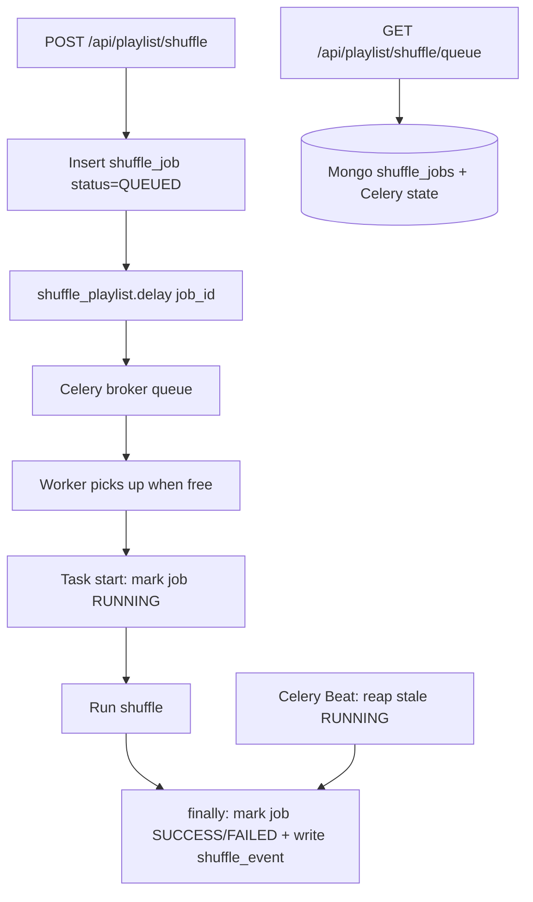

# Backend Plan: Shuffle Queue + Polling Endpoint

## 1. Goal

Let a user **enqueue any number of playlist shuffles**. There is **no per-user
limit, no serialization, and no same-playlist concurrency guard** — concurrency
throttling is handled by the frontend, which will restrict how many calls it makes.
Expose an **endpoint the frontend can poll to retrieve all queued and in-progress
shuffles** for the current user, so state survives a page refresh and the UI can
show the queue.

### Requirements

1. No per-user cap and no concurrency check: a user may enqueue as many shuffles
   as they want; workers pick them up as they finish. Call throttling is the
   frontend's responsibility.
2. Persist queued/in-progress state in the backend so the frontend can restore it
   after a refresh (the frontend state currently lives only in React component
   state and is lost on unmount).
3. Provide a single polling endpoint that returns **all** queued and in-progress
   shuffles for the current user (with progress state merged in), excluding
   terminal history, which stays on `GET /api/user/shuffle/recent`.
4. Jobs and state remain scoped per user.

> This supersedes the earlier drafts: the "one active shuffle per user" design and
> the "same-playlist concurrency guard" are both **removed**.

---

## 2. Current behavior (as-is)

- `POST /api/playlist/shuffle` →
  `playlist_service.queue_create_shuffled_playlist()`
  (`backend/app/services/playlist_service.py:139`) directly calls
  `playlist_tasks.shuffle_playlist.delay(...)` and returns
  `{"shuffle_task_id": result.id}`.
- The frontend (`frontend/src/features/shuffle/components/PlaylistContainer.js`)
  stores that task id in component state and polls
  `GET /api/playlist/shuffle/state/<id>` (`tasks/task_state.py`), reading the
  Celery `AsyncResult` from Redis.
- There is **no server-side record** of a user's queued/in-progress shuffles, and
  no endpoint to enumerate them — hence state is lost on refresh.
- `shuffle_playlist` declares `expires=60` — a task not picked up within 60s is
  discarded. This is a problem once tasks legitimately sit in a backlog.
- Local worker runs `--pool=solo`; **prod runs `--pool=prefork`**
  (`backend/docker/prod/celery.Dockerfile`), so multiple jobs can run at once.

---

## 3. Can Celery support this? (analysis)

With the restrictions removed, most of what we need is **Celery's default
behavior**:

| Need | Celery support |
| --- | --- |
| Enqueue many, run as workers free up | **Native.** Broker queue + worker pool. Concurrency (`--concurrency`) controls throughput; ordering is FIFO-ish. |
| Retries / backoff | Native (`self.retry`, `autoretry_for`). |
| Route shuffles separately | Native (`task_routes`, separate worker on a `shuffle` queue). |
| Durable, enumerable state for polling | **Not native.** Celery results are ephemeral (`result_expires=3600`) and are not queryable per user. Use Mongo. |

**Conclusion:** Use Celery's broker as the queue (no custom dispatcher needed). Add
a Mongo `shuffle_jobs` collection as the durable, per-user-queryable layer that
powers the new polling endpoint.

---

## 4. Architecture



Key properties:

- **Queue = Celery broker.** No dispatcher, no per-user serialization.
- **`shuffle_jobs` = durable visibility layer**, powering the poll endpoint.
- **No concurrency guard.** Duplicate/simultaneous enqueues are allowed.

---

## 5. Data model

### 5.1 New collection: `shuffle_jobs`

Durable projection of each enqueued shuffle.

```jsonc
{
  "_id": ObjectId,
  "user_id": "spotify_user_id",
  "playlist_id": "playlist_id",
  "playlist_name": "My Playlist",
  "shuffle_type": "REUSE_EXISTING_PLAYLIST",
  "status": "QUEUED" | "RUNNING" | "SUCCESS" | "FAILED" | "CANCELLED",
  "auth": { /* spotify_auth.to_dict() — needed by the worker at run time */ },
  "celery_task_id": "…" | null,
  "created_at": ISODate,
  "started_at": ISODate | null,
  "finished_at": ISODate | null,
  "error_message": string | null,
  "result": { /* playlist_uri, playlist_trimmed, … */ } | null
}
```

Notes:
- `auth` is stored because a job may execute well after enqueue. Tokens are already
  persisted in `sessions`; purge `auth` on completion and add a TTL index as a
  backstop.
- Keep `shuffle_events` unchanged as the audit/history log for existing stats.

### 5.2 Indexes

```python
db.shuffle_jobs.create_index([("user_id", 1), ("created_at", 1)])  # poll listing
db.shuffle_jobs.create_index([("user_id", 1), ("status", 1)])      # filter active
db.shuffle_jobs.create_index([("status", 1), ("started_at", 1)])    # reaper
db.shuffle_jobs.create_index("created_at", expireAfterSeconds=...)  # optional TTL
```

### 5.3 Database functions (`backend/app/database/database.py`)

- `insert_shuffle_job(job)`
- `find_shuffle_job(job_id)`
- `mark_shuffle_job_running(job_id, celery_task_id=None)`
- `complete_shuffle_job(job_id, status, result=None, error_message=None, clear_auth=True)`
- `find_user_shuffle_jobs(user_id, statuses=None, limit=None)` — ordered by
  `created_at`; filters to `[QUEUED, RUNNING]` for the poll endpoint
- `find_user_shuffle_jobs_finished_since(user_id, since)` — for the optional
  `completed` delta in the poll response (§6.2)
- `find_stale_running_shuffle_jobs(cutoff)` — reaper

---

## 6. API contract

### 6.1 `POST /api/playlist/shuffle` (modified)

Request unchanged: `{playlist_id, playlist_name, shuffle_type}`.

Behavior:
1. Insert a `shuffle_jobs` doc (`status=QUEUED`, `auth`).
2. `shuffle_playlist.delay(auth, playlist_id, playlist_name, correlation_id, shuffle_type, shuffle_job_id=...)`.
3. Store `celery_task_id`; return.

Response:

```jsonc
{
  "job_id": "…",
  "status": "QUEUED",
  "shuffle_task_id": "…"
}
```

`shuffle_task_id` is kept for backward compatibility. No 409 path — duplicates are
allowed.

### 6.2 `GET /api/playlist/shuffle/queue` (new) — poll endpoint

Returns the **volatile** set for the authenticated user: everything currently
queued or in progress, with Celery progress merged in so one poll is enough (no
per-job `/state` calls). This is what the frontend calls on mount to restore state
after a refresh, and then polls while work is outstanding.

**Terminal history is deliberately excluded.** Finished shuffles do not change
between polls, so re-sending them on every tick is redundant payload, and there is
already a dedicated endpoint for the sidebar history: `GET /api/user/shuffle/recent`
(the frontend already calls this on mount via `fetchRecentShuffles`). Keep the poll
small and bounded; source `recent` from its own endpoint.

```jsonc
{
  "polled_at": "2026-10-10T12:00:00Z",   // server time; client echoes as `since`
  "in_progress": [
    {
      "job_id": "…",
      "playlist_id": "…",
      "playlist_name": "…",
      "state": "PROGRESS",              // merged Celery state
      "message": "Shuffling 120 tracks…",
      "playlist_uri": null,
      "celery_task_id": "…",
      "created_at": "…",
      "started_at": "…"
    }
  ],
  "queued": [
    {
      "job_id": "…",
      "playlist_id": "…",
      "playlist_name": "…",
      "created_at": "…"
    }
  ],
  "completed": [ /* optional: jobs that finished since `?since=` */ ]
}
```

- Ordered by `created_at` (oldest first) so the frontend can render queue order.
- `state`/`message` are produced by merging the DB job with the Celery
  `AsyncResult` via `tasks/task_state.py`. If the DB says `RUNNING` but Redis has
  no result yet, report `PENDING`.

#### Not losing completions

A job flips `RUNNING → SUCCESS`/`FAILED` exactly once. If the poll returns only
active jobs, the frontend sees the job in one tick and gone the next, never
observing the final result (`playlist_uri`, `playlist_trimmed`, `error_message`).
Close that gap with one of:

- **Recommended — `since` cursor.** The client sends
  `?since=<polled_at from the previous response>`; the response additionally
  includes a `completed` array of jobs with `finished_at > since`, carrying the
  final state/result. Each completion is delivered exactly once, then the client
  advances its cursor to the new `polled_at`. Using server time avoids clock-skew
  issues.
- **Lighter alternative.** The frontend remembers the active job ids it has seen;
  when one disappears it fetches `GET /api/user/shuffle/recent` (and/or
  `GET /shuffle/state/<celery_task_id>`) for the result. Fewer backend query
  params, but more frontend logic and a small race window.
- **If the final result need not be delivered by the poll**, drop `completed`
  entirely and rely on the frontend plus `/api/user/shuffle/recent`.

> `completed` is a transition *delta* keyed off the client's cursor — it is not the
> same as `recent` (the stable last-N history), which stays on
> `/api/user/shuffle/recent`.

### 6.3 `GET /api/playlist/shuffle/state/<id>` (unchanged)

Keep for polling a specific active job (`id` = Celery task id). The new queue
endpoint is preferred going forward.

### 6.4 `DELETE /api/playlist/shuffle/queue/<job_id>` (optional, later)

Cancel a `QUEUED` job → `CANCELLED`. Not required by scope.

---

## 7. Task-layer changes (`backend/app/tasks/playlist_tasks.py`)

1. Extend `shuffle_playlist` with an optional `shuffle_job_id`:

```python
@shared_task(bind=True, ignore_result=False, expires=...)
def shuffle_playlist(self, spotify_auth_dict, playlist_id, playlist_name,
                     correlation_id=None, shuffle_type=..., shuffle_job_id=None):
```

2. At task start, if `shuffle_job_id`, call
   `database.mark_shuffle_job_running(shuffle_job_id, self.request.id)`.

3. In the existing `finally` block (after `insert_shuffle_event`), if
   `shuffle_job_id`, call `database.complete_shuffle_job(...)` with the derived
   `status`/`result`/`error_message`. Guard against marking a retry as terminal
   (only complete once, and not on the `SKIPPED`/retry path if retries are added).

4. **Revisit `expires=60`.** Tasks now legitimately wait in a backlog, so a 60s
   expiry would silently drop queued work. Remove `expires` or raise it well beyond
   the max expected queue wait. **This is a must-fix.**

5. **Reaper** (Beat): mark `RUNNING` jobs older than a timeout as `FAILED` so the
   poll endpoint doesn't report phantom in-progress jobs after a worker crash.
   (There is no lock to release now — this is purely for accurate state.)

### 7.1 Celery / infra configuration

- `worker_prefetch_multiplier = 1` and `task_acks_late = True` so a worker doesn't
  pre-grab tasks it hasn't started (keeps ordering meaningful, avoids work loss on
  crash).
- Optionally route shuffle tasks to a dedicated `shuffle` queue (`task_routes`) so
  analysis/aggregation tasks can't starve shuffles; run a worker for it.
- Add **Celery Beat** for the reaper service (new service or `-B`).
- Parallelism is controlled purely by worker `--concurrency`; the frontend
  throttles how many jobs a user requests.

---

## 8. Service / controller changes

- `backend/app/services/shuffle_queue_service.py` (new):
  - `enqueue_shuffle(spotify_auth, playlist_id, playlist_name, shuffle_type)`
    (insert + delay + return job/task ids)
  - `get_user_queue(spotify_auth)` (build the §6.2 payload)
- `backend/app/services/playlist_service.py`:
  - Replace the body of `queue_create_shuffled_playlist` with
    `shuffle_queue_service.enqueue_shuffle(...)`.
- `backend/app/controllers/playlist_controller.py`:
  - `queue_shuffle_playlist` returns the new payload.
  - Add `get_shuffle_queue` for `GET /api/playlist/shuffle/queue`.
- `backend/app/main.py`:
  - Add `task_routes` / `worker_prefetch_multiplier` / `task_acks_late` to the
    `CELERY` mapping.
- `backend/app/utils/constants.py`: add `SHUFFLE_JOB_*` status keys.

---

## 9. Frontend contract (backend-driven)

- On mount / refresh, call `GET /api/playlist/shuffle/queue` and render
  `in_progress` and `queued`. Separately, load history via the existing
  `GET /api/user/shuffle/recent`.
- Poll the queue endpoint on an interval while any job is active; stop (or slow
  down) when `in_progress` and `queued` are both empty. Pass the previous
  response's `polled_at` as `?since=` to receive `completed` deltas, and update the
  recent list when a job finishes.
- On enqueue, use the returned `job_id`/`shuffle_task_id`.
- The frontend enforces its own cap on concurrent calls to the backend.
- No FE state needs to survive navigation because the server holds it.

(FE follow-up files: `PlaylistContainer.js`, `services/PlaylistApiService.js`,
`state/PlaylistShuffleState.js`.)

---

## 10. Edge cases & correctness

- **Duplicate / simultaneous enqueues:** allowed by design; frontend throttles.
- **Worker crash mid-shuffle:** the reaper marks the job `FAILED` so the poll
  endpoint converges. Without it, a job can appear in-progress forever.
- **Token expiry while queued:** worker refreshes via `create_spotify_client`; fail
  cleanly if refresh is impossible.
- **Ordering:** with `prefetch_multiplier=1` a single queue is roughly FIFO, but
  multi-worker timing means ordering is not strict.
- **`expires=60`:** must be removed/raised (§7.4).
- **Auth purge:** clear `auth` on completion; TTL index as backstop.
- **Two jobs writing the same destination playlist** (`[Shuffled] <name>`): a known,
  accepted risk now that the guard is removed; the frontend is expected to avoid
  issuing simultaneous shuffles for the same playlist.

---

## 11. Test plan

Functional tests (existing patterns under
`backend/app/tests/functional/{services,controllers,tasks}`):

- DB layer: insert/list jobs; status transitions; reaper selection.
- Service: `enqueue_shuffle` inserts a QUEUED job and dispatches; `get_user_queue`
  splits `in_progress`/`queued`, merges Celery state, and returns `completed`
  deltas for a given `since` cursor.
- Task: `finally` marks the job `SUCCESS`/`FAILED`; `mark_shuffle_job_running` on
  start.
- Controller: `POST /shuffle` response shape; `GET /shuffle/queue` snapshot with
  multiple in-progress and queued jobs and a `since`-bounded `completed` array;
  auth failure paths.
- **Update existing tests** that assume the old response:
  - `backend/app/tests/functional/services/test_shuffle_service.py`
    (`test_queue_shuffle_playlist_success` asserts `shuffle_task_id == "test_id"`)
  - `backend/app/tests/functional/controllers/test_playlist_controller.py`
    (`test_queue_shuffle_playlist_success` mocks `queue_create_shuffled_playlist`
    → `{"shuffle_task_id": "mocked_task_id"}`)

---

## 12. Rollout

1. Add `shuffle_jobs` collection + indexes (idempotent init helper at startup; no
   migrations framework exists).
2. Ship `POST /shuffle` + the new `GET /shuffle/queue` endpoint, keeping
   `shuffle_task_id` for the current frontend.
3. Update the frontend to poll `GET /shuffle/queue` for restore + queue UI and to
   enforce its own call cap.
4. Remove/raise `expires` on `shuffle_playlist`; enable the Beat reaper; optionally
   add the `shuffle` queue worker.
5. Monitor via `shuffle_events` + `X-Correlation-ID`.

---

## 13. Open questions

- Polling cadence and whether to add conditional/ETag/long-polling to reduce load.
- Do we need the `completed` delta (`?since=`), or is dropping completed jobs and
  relying on the frontend + `/api/user/shuffle/recent` sufficient?
- `limit` on `recent` (e.g. last 10) — in `/api/user/shuffle/recent`, not the poll.
- Should terminal jobs be pruned from `shuffle_jobs` immediately, kept for a short
  window (so `completed` can be served), or only reported from `shuffle_events`?
- Does the liked-tracks "create playlist" job
  (`create_playlist_from_liked_tracks`) also need to appear in the poll endpoint?
